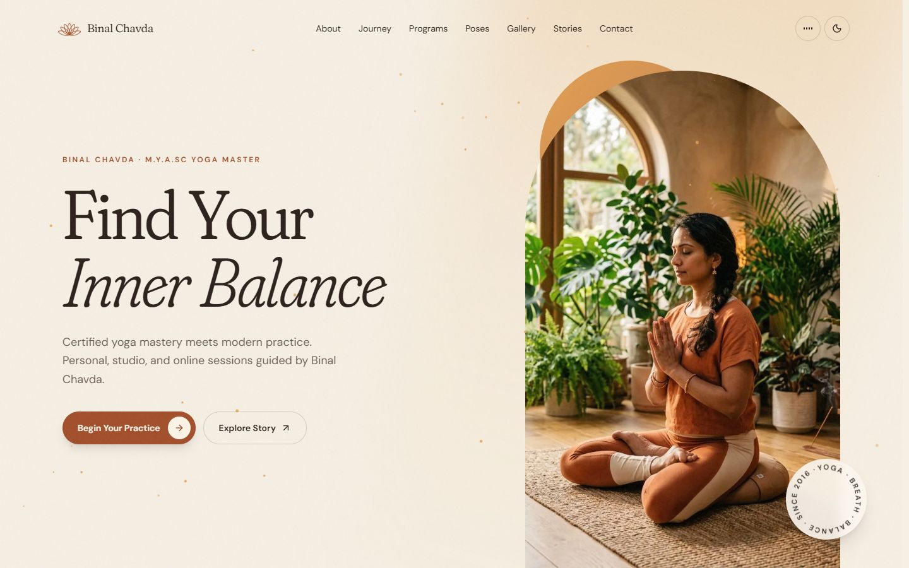
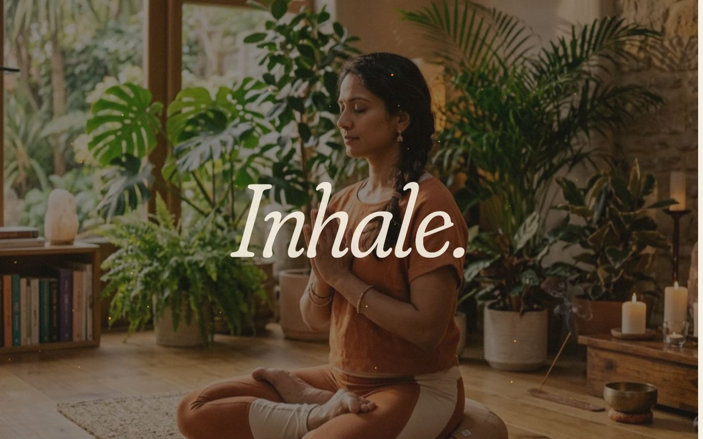
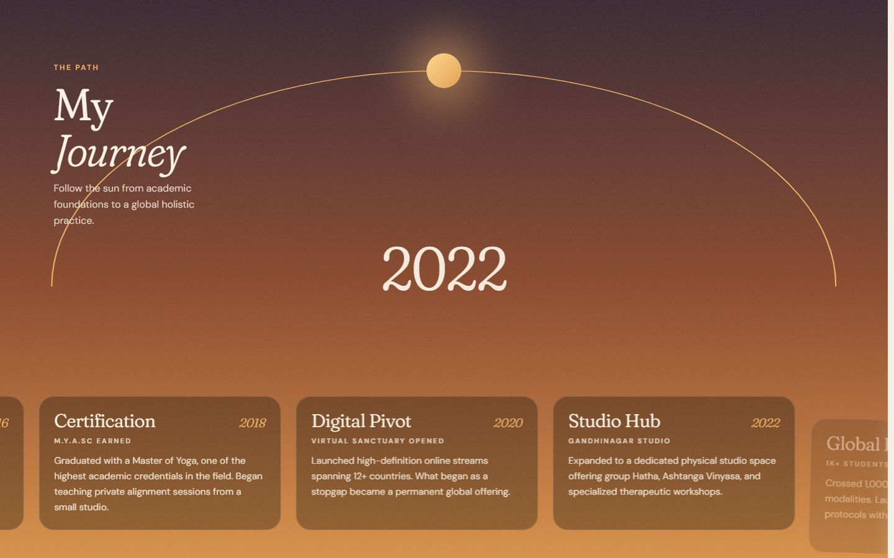
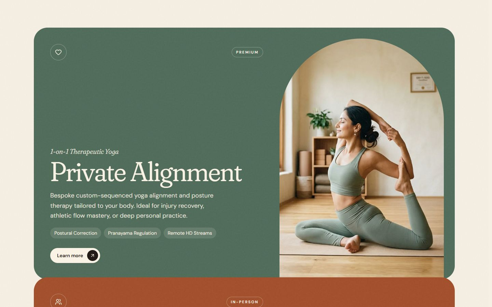
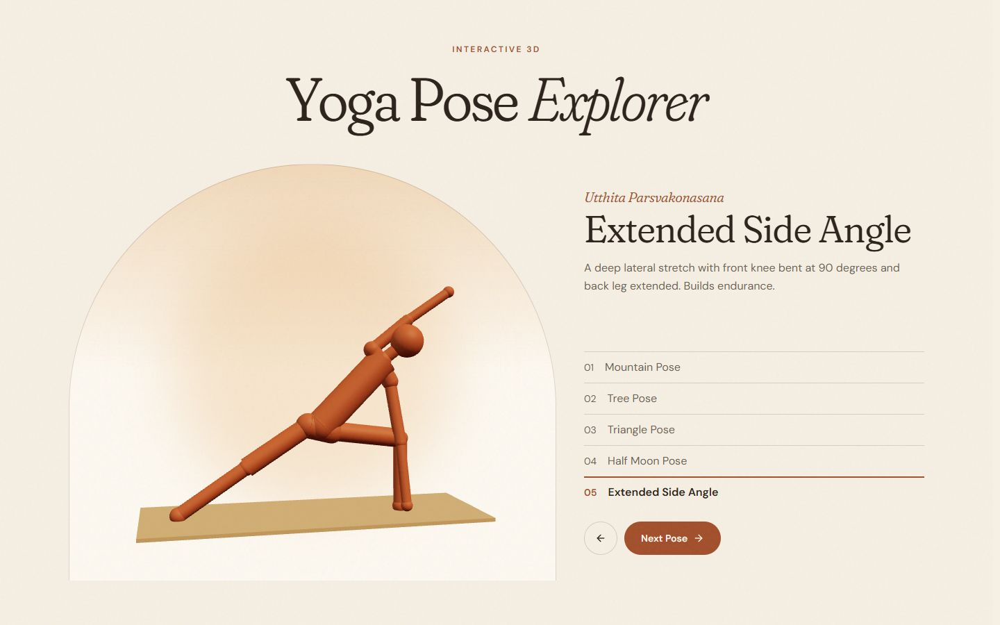
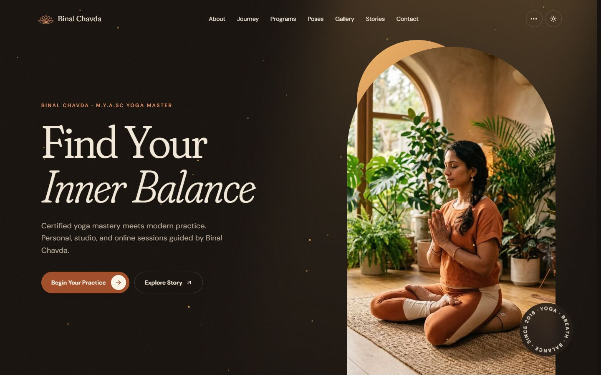
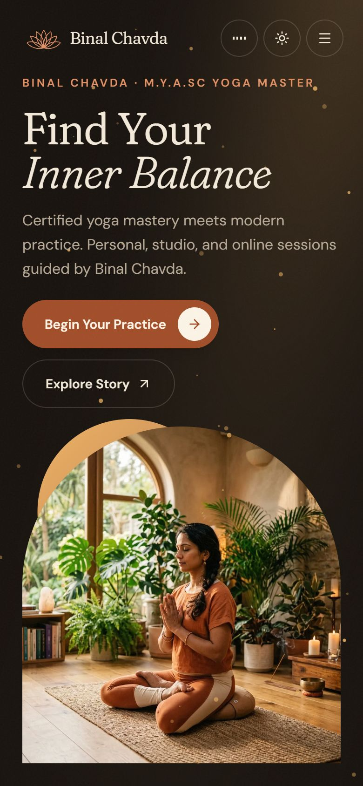

<div align="center">


# Binal Chavda Yoga

**Find your inner balance.**

An animated portfolio for Binal Chavda, an M.Y.A.Sc yoga teacher offering personal, studio and online sessions from Gandhinagar, India.


<br />



</div>

## The idea

The site is designed like one slow breath through a sunlit studio. Its colours come straight from the photos: plaster walls, warm oak, and Binal's sage, terracotta and plum practice wear. The arched studio window repeats as the shape that frames her photos.

## A walk through the page

| | |
|---|---|
|  | **Take a breath**<br />The arched photo opens to fill the screen as you scroll, and the page breathes with you: *Inhale. Exhale. Begin.* |
|  | **Follow the sun**<br />The sun crosses the sky from 2016 to 2026 while the milestone cards slide past and the sky shifts from dawn to dusk. |
|  | **Choose a practice**<br />Three full-colour program cards stack as you scroll, and each opens a panel with the styles and credentials behind it. |
|  | **Explore the poses**<br />A 3D figure moves between five classical poses. Drag it with a mouse to look around. |

### Also inside

- 🌅 **Opening breath:** a loader that follows real image and font loading
- 🌙 **Day and night themes:** the new theme spreads out in a circle from the toggle
- 🔔 **Ambient sound:** an optional soundscape generated in the browser, with no audio files
- 🖼️ **Moving gallery:** columns drift at different speeds, with a keyboard-friendly photo viewer
- 💬 **Student stories:** testimonial ribbons that pause on hover
- 📜 **Certificate deck:** swipe, drag or click through the credentials
- ✉️ **Contact form:** sends through EmailJS, or opens the visitor's email app until that is set up

<table>
  <tr>
    <td width="70%"></td>
    <td width="30%"></td>
  </tr>
  <tr>
    <td align="center"><sub>Night theme</sub></td>
    <td align="center"><sub>On a phone</sub></td>
  </tr>
</table>

## Built for everyone

- **Reduced motion:** with the system setting on, the loader, pinned scenes and smooth scrolling are skipped and all content stays readable.
- **Phones:** the horizontal journey becomes a vertical timeline, and the 3D figure never traps page scrolling.
- **Fast first load:** the 3D scene loads only when you get near it, and if WebGL isn't available a simple fallback takes its place.
- **Keyboard:** popups close with <kbd>Esc</kbd>, and the photo viewer also responds to <kbd>←</kbd> and <kbd>→</kbd>.

## Get started

You need [Node.js](https://nodejs.org) 18 or newer.

```bash
git clone https://github.com/AbbY2/Binal-Maru.git
```

```bash
cd Binal-Maru
```

```bash
npm install
```

```bash
npm run dev
```

The site then runs at <http://localhost:3000>.

| Command | What it does |
|---|---|
| `npm run dev` | Starts the dev server on port 3000 |
| `npm run build` | Creates the production build in `dist/` |
| `npm run preview` | Serves the production build locally |
| `npm run lint` | Type-checks the project |

## Set up contact emails (optional)

Without any setup, the contact form opens the visitor's email app with their message filled in. To send messages directly from the site, create a free [EmailJS](https://www.emailjs.com) account and add these values to a `.env.local` file:

```ini
VITE_EMAILJS_SERVICE_ID="your_service_id"
VITE_EMAILJS_PUBLIC_KEY="your_public_key"
VITE_EMAILJS_CONTACT_TEMPLATE_ID="your_contact_template_id"
```

Your EmailJS template can use `{{name}}`, `{{email}}`, `{{program}}` and `{{message}}`.

## Deploy

This is a static site, so it works on hosts such as Vercel, Netlify or Cloudflare Pages:

| Setting | Value |
|---|---|
| Build command | `npm run build` |
| Output folder | `dist` |

If you use EmailJS, add the same `VITE_` variables in your host's settings before building.

## Project structure

```text
public/images/         Photos used by the site
docs/screenshots/      Images used in this README
src/
├── App.tsx            Page layout, theme, sound and the program panel
├── index.css          Colour tokens, type and shared animation styles
├── animations/        Shared easing curves
├── hooks/             Smooth scrolling
├── lib/               Scroll locking and email settings
└── components/
    ├── Hero, About, Journey, Programs, PoseViewer, Stats,
    │   Gallery, Testimonials, Certificates, FAQ, Contact
    ├── Layout/        Navbar, footer, loader and cursor
    ├── ui/            Text reveals, marquee, lotus mark and other shared pieces
    ├── sound/         Ambient sound engine
    └── booking/       Booking calendar, not yet on the page
```

## Built with

[React](https://react.dev) · [TypeScript](https://www.typescriptlang.org) · [Vite](https://vite.dev) · [Tailwind CSS](https://tailwindcss.com) · [Motion](https://motion.dev) · [GSAP](https://gsap.com) · [Lenis](https://lenis.darkroom.engineering) · [React Three Fiber](https://r3f.docs.pmnd.rs) · [EmailJS](https://www.emailjs.com) · [Fraunces](https://fonts.google.com/specimen/Fraunces) and [DM Sans](https://fonts.google.com/specimen/DM+Sans)

<div align="center">
<br />
<sub>Breathe in. Breathe out. Begin.</sub>
</div>
